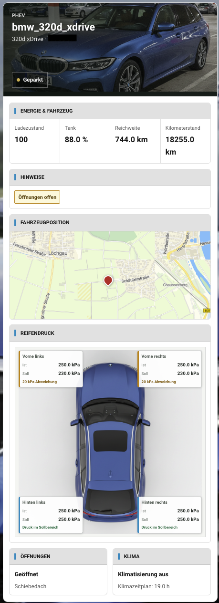

# BMW Status Card

[English](README.md) | [BMW Status Backend](https://github.com/lweberru/bmw_status)

BMW Status Card ist das Lovelace-Frontend fuer die
[BMW Status](https://github.com/lweberru/bmw_status)-Integration fuer Home
Assistant. Beide Repositories bilden eine gemeinsame Loesung: Das Backend besitzt
Fahrzeug-Erkennung, Provider-Zugriffe, semantische Klassifizierung, Karten und
Asset-Caching; diese Karte rendert ausschliesslich die versionierte Praesentation
des Backends.

Version: 0.2.10



## Funktionen

- Fahrzeuguebersicht mit Energie, Tank, Reichweite, Kilometerstand und Verriegelung.
- Serverseitig gerenderte Fahrzeug- und Positionsbilder ohne Provider-Schluessel im Browser.
- Semantische Warnhinweise fuer relevante Fahrzeugzustaende.
- Vollbreite Reifendruckansicht mit Ist- und Sollwerten pro Reifen.
- Zusammenfassungen fuer Oeffnungen, Service und Klima.

## Voraussetzungen

1. Installiere und konfiguriere das [BMW Status Backend](https://github.com/lweberru/bmw_status)
   als HACS-**Integration**.
2. Richte es fuer ein Fahrzeug ein. Es stellt einen BMW-Status-Sensor bereit, zum
   Beispiel `sensor.status`.
3. Installiere dieses Repository ueber HACS als **Frontend**-Plugin.

## Installation

Falls HACS die Lovelace-Ressource nicht automatisch hinzufuegt, registriere sie
als Modul:

- URL: `/hacsfiles/bmw_status_card/bmw-status-card.js`
- Typ: `module`

## Konfiguration

```yaml
type: custom:bmw-status-card
entity: sensor.status
```

Die Entitaet muss der vom BMW Status Backend bereitgestellte Sensor sein. Die
Karte liest ausschliesslich `attributes.presentation`. Sie greift im Browser nicht
auf CarData, externe Provider oder Karten-APIs zu und nimmt keine
Provider-Zugangsdaten entgegen.

## Praesentationsvertrag

BMW Status veroeffentlicht Schema-Version `1`. Die Karte rendert diese
semantischen Werte:

- `vehicle`, `status` und `electrification`
- `entities` fuer Energie, Tank, Reichweite, Kilometerstand und Verriegelung
- `groups` fuer Oeffnungen, Reifen, Service und Klima
- `badges` fuer semantische Warnungen
- `images` und `location_image` fuer backend-generierte, lokal gecachte Assets

Aktualisiere Backend und Frontend gemeinsam, wenn ein Release diesen Vertrag
aendert.
