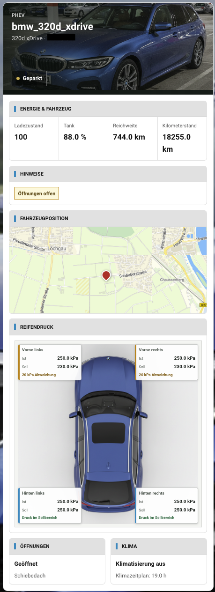

# BMW Status Card

[Deutsch](README.de.md) | [BMW Status backend](https://github.com/lweberru/bmw_status)

BMW Status Card is the Lovelace frontend for the
[BMW Status](https://github.com/lweberru/bmw_status) Home Assistant integration.
The two repositories form one solution: the backend owns vehicle discovery,
provider access, semantic classification, maps and visual-asset caching; this
card renders only the backend's versioned presentation.

Version: 0.2.9



## Features

- Vehicle overview with energy, fuel, range, odometer and lock state.
- Server-rendered vehicle and location images without browser-side provider keys.
- Semantic warning badges for relevant vehicle conditions.
- Full-width tire-pressure view with actual and target values per wheel.
- Opening, service and climate summaries.

## Requirements

1. Install and configure the [BMW Status backend](https://github.com/lweberru/bmw_status)
   as a HACS **Integration**.
2. Complete its setup for one vehicle. It exposes a BMW Status sensor, for
   example `sensor.status`.
3. Install this repository through HACS as a **Frontend** plugin.

## Installation

Add the Lovelace resource as a module if HACS has not added it automatically:

- URL: `/hacsfiles/bmw_status_card/bmw-status-card.js`
- Type: `module`

## Configuration

```yaml
type: custom:bmw-status-card
entity: sensor.status
```

The entity must be the sensor provided by BMW Status. The card reads only its
`attributes.presentation` value. It does not call CarData, external providers or
map APIs from the browser and does not accept provider credentials.

## Presentation contract

BMW Status publishes schema version `1`. The card renders these semantic values:

- `vehicle`, `status` and `electrification`
- `entities` for energy, fuel, range, odometer and lock state
- `groups` for openings, tires, service and climate
- `badges` for semantic warnings
- `images` and `location_image` for backend-generated, locally cached assets

Update the backend and frontend together when a release changes this contract.
